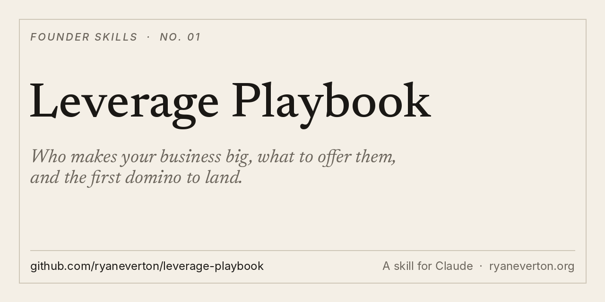

<p align="center"></p>

# Leverage Playbook

**The leverage playbook I learned from Guy Oseary and Ashton Kutcher, turned into a go-to-market plan for any business.**

A skill for Claude and other agents. Give it your business. Get back who makes you big, what to offer them, and the first domino to land.

[Install](#install) · [What it makes](#what-it-makes) · [Use it](#use-it) · [Why I built it](#why-i-built-it)

## What it makes

One GTM plan, as a markdown doc:

- **Currency inventory.** Everything you can spend that isn't the product.
- **Platform definition.** What you sell vs. what you actually accumulate.
- **Leverage map.** Growth partners, door-openers, the leverage hire, position.
- **The day-after test.** Who survives, ranked by the doors they open.
- **Offers.** What you give, what you get, what happens on day one. Equity and access, never discounts.
- **Engagement sequence.** Warm paths and the first domino.
- **Ownership layer.** The stakes worth owning.
- **A 90-day plan.**

## Install

**Claude Code**

```
/plugin marketplace add ryaneverton/leverage-playbook
/plugin install leverage-playbook@leverage-playbook
```

**Any agent (Cursor, Codex, Gemini CLI and more)**

```
npx skills add ryaneverton/leverage-playbook
```

**Claude app (web and desktop)**

1. Download [leverage-playbook.zip](https://github.com/ryaneverton/leverage-playbook/raw/main/dist/leverage-playbook.zip)
2. In Claude, open **Customize › Skills**, click **+**, then **Create skill › Upload a skill**
3. Upload the ZIP

**Manual**

```
git clone https://github.com/ryaneverton/leverage-playbook
cp -r leverage-playbook/skills/leverage-playbook ~/.claude/skills/
```

## Use it

- "Run the leverage playbook on my business. We sell [X] to [Y]."
- "Who makes [company] big? Build me a leverage map."
- "We need three distribution partners in 90 days. Run the playbook."

## Why I built it

My last company, TURN, was backed by Sound Ventures (Guy Oseary and Ashton Kutcher's fund), Live Nation and T. Rowe Price. Live Nation didn't just invest. It rolled TURN out across its festivals and venues.

That taught me the difference between a business and a position. The product gets you considered. Leverage gets you chosen. Ask who someone follows before you ask for the meeting. Pay for access with ownership, not cash. Sit where the people you need already walk.

This skill is that playbook, written so Claude can run it on any business.

The stories behind it:

- [What Guy Oseary Taught Me about Business](https://ryaneverton.substack.com/p/what-guy-oseary-taught-me-about-business)
- [What Hollywood taught me about the difference between a business and a position](https://ryaneverton.substack.com/p/what-hollywood-taught-me-about-the)

## Pairs with

- [gtm-execution-playbook](https://github.com/ryaneverton/gtm-execution-playbook): how to sell it week to week
- [pilot-to-scale-gtm](https://github.com/ryaneverton/pilot-to-scale-gtm): turn pilots into contracts, and contracts into expansion
- [founder-daily-operator](https://github.com/ryaneverton/founder-daily-operator): run several companies with agents, safely

## About

Built by [Ryan Everton](https://ryaneverton.org). I write [The Intuitive Founder](https://ryaneverton.substack.com), on pragmatic AI and the inner work of building something real.

If this helped, star the repo and tell me what you ran it on: [@ryandeverton](https://x.com/ryandeverton).

MIT License.
